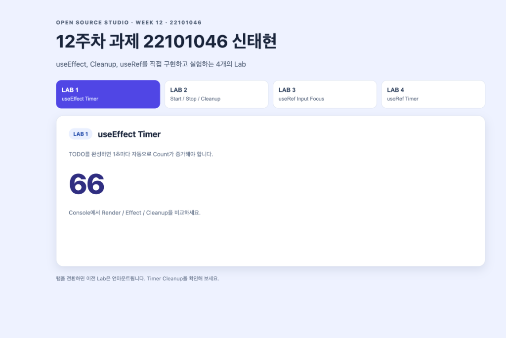

# OSS Week 12 - React Hooks Playground

React의 `useEffect`, Cleanup, `useRef` 동작 원리를 4개의 실습(Lab 1~4)으로 직접 구현하고 비교·분석하는 12주차 과제 프로젝트입니다.

- 작성자: 22101046 신태현
- 원본 프로젝트(Starter): https://github.com/2026-2-OSS/week12_starter_project
- Vercel 배포 URL: https://wk12-assignment.vercel.app/

## 실행 방법

```bash
npm install
npm run dev
npm run build
```

## 실행 화면



## 1. Source Code Exploration

### Project Structure
- `src/App.jsx`: 상단 헤더와 4개 Lab 탭을 관리하며, 선택된 Lab 컴포넌트만 렌더링합니다. 탭을 바꾸면 이전 Lab은 언마운트됩니다.
- `src/components/Lab1_EffectTimer.jsx`: `useEffect`와 `setInterval`로 1초마다 카운트가 증가하고, 언마운트 시 Cleanup으로 타이머를 정리합니다.
- `src/components/Lab2_TimerControl.jsx`: `running` State와 Dependency Array(`[running]`)를 이용해 Start, Stop, Reset을 제어합니다.
- `src/components/Lab3_InputFocus.jsx`: `useRef`로 `<input>` DOM에 접근하여 Focus 및 입력값 초기화(Clear)를 수행합니다.
- `src/components/Lab4_RefTimer.jsx`: `useRef`에 Timer ID를 보관해 타이머를 제어하고, 언마운트 시 Cleanup으로 정리합니다.

### `useEffect`와 `useRef` 동작 원리
- **useEffect**: 렌더링 이후 부수 효과(타이머 등)를 실행합니다. Dependency Array(`[]`, `[running]` 등)로 재실행 조건을 정하고, 반환하는 Cleanup 함수로 언마운트나 재실행 직전에 기존 타이머를 정리합니다.
- **useRef**: `{ current: 초기값 }` 형태로 값을 보관합니다. `useState`와 달리 `.current` 값을 바꿔도 리렌더링이 발생하지 않으며, DOM 참조나 타이머 ID 보관에 사용합니다.

### Code Analysis

**1) `useEffect` 코드 (`src/components/Lab2_TimerControl.jsx`)**

```jsx
useEffect(() => {
  if (!running) return;
  const timerId = setInterval(() => {
    setCount((prev) => prev + 1);
  }, 1000);
  return () => {
    clearInterval(timerId);
  };
}, [running]);
```

`running`이 `true`로 바뀌면 `setInterval`이 시작되고, `setCount((prev) => prev + 1)` 함수형 업데이트로 최신 상태를 기준으로 1씩 증가합니다. `running`이 `false`가 되거나 탭이 전환되면 Cleanup에서 `clearInterval(timerId)`가 실행되어 타이머가 정리됩니다.

**2) `useRef` 코드 (`src/components/Lab4_RefTimer.jsx`)**

```jsx
const timerRef = useRef(null);

const start = () => {
  if (timerRef.current) return;
  setRunning(true);
  timerRef.current = setInterval(() => {
    setCount((prev) => prev + 1);
  }, 1000);
};
```

타이머 ID는 화면에 표시할 필요가 없으므로 `timerRef.current`에 저장해 불필요한 리렌더링을 막습니다. `if (timerRef.current) return;` 조건으로 이미 실행 중인 타이머가 있을 때 중복 시작을 방지합니다.

## 2. Lab 구현 내용 및 실행 결과

- **LAB 1 (`useEffect` Timer)**: `useEffect(..., [])` 내부에서 `setInterval`과 함수형 업데이트(`setCount(prev => prev + 1)`)로 1초마다 카운트가 증가하도록 구현했습니다.
  - 실행 결과: 화면 진입 시 1초마다 카운트가 증가하며, 콘솔에서 `[LAB 1] rendered` → `[LAB 1] effect start`를 확인했고, 다른 탭으로 전환 시 `[LAB 1] cleanup`이 출력되며 타이머가 정리되었습니다. (의존성 배열 `[]` 생략 시 매초 Cleanup과 Effect가 반복 실행됨을 관찰)
- **LAB 2 (Timer Start / Stop / Reset)**: `running` State를 Dependency Array(`[running]`)로 지정해 `true`일 때만 `setInterval`을 실행하고, Cleanup으로 타이머를 종료하도록 구현했습니다.
  - 실행 결과: Start 클릭 시 `Running` 상태로 1초마다 증가하고 중복 실행이 방지되며, Stop 클릭 시 중지, Reset 클릭 시 `Stopped` 상태와 함께 카운트가 `0`으로 초기화되었습니다.
- **LAB 3 (Input Focus with `useRef`)**: `useRef(null)`로 `inputRef`를 생성해 `<input>`에 연결하고, `.current.focus()`와 `.current.value = ''`로 DOM을 직접 제어했습니다.
  - 실행 결과: Focus 버튼 클릭 시 입력창으로 커서가 이동하며, Clear 버튼 클릭 시 입력 내용이 지워지고 입력창에 다시 포커스가 맞춰졌습니다.
- **LAB 4 (Timer with `useRef`)**: `timerRef.current`에 타이머 ID를 저장해 Start / Stop / Reset을 제어하고, 언마운트 시 `useEffect` Cleanup으로 실행 중인 타이머를 정리했습니다.
  - 실행 결과: Start / Stop / Reset 모두 정상 동작하고 중복 실행이 방지되며, `MM:SS` 형식으로 시간이 표시되었습니다. 실행 중 다른 탭으로 이동해도 백그라운드 타이머가 정상 정리되고 브라우저 콘솔 오류는 발생하지 않았습니다.

## 3. Lab 비교 분석

1. **`useEffect`의 Dependency Array가 필요한 이유는?**
   Dependency Array를 생략하면 매 렌더링마다 Effect가 다시 실행되어 타이머가 계속 새로 만들어집니다. `[]`(마운트 시 1회)나 `[running]`(특정 상태 변경 시)처럼 실행 시점을 제어하기 위해 필요합니다.

2. **Cleanup을 사용하지 않으면 어떤 문제가 발생할 수 있는가?**
   컴포넌트가 언마운트되거나 Effect가 재실행되어도 이전 타이머가 백그라운드에서 계속 남아 메모리 누수와 타이머 중복 실행(속도가 빨라지는 현상)이 발생합니다. 특히 개발 환경의 `StrictMode`에서는 마운트-언마운트-재마운트가 한 번 더 실행되므로 Cleanup이 없으면 처음부터 타이머가 2개 동작합니다.

3. **`useState`와 `useRef`의 가장 중요한 차이는?**
   값 변경 시 리렌더링 여부입니다. `useState`는 값이 바뀌면 화면을 다시 그리지만, `useRef`는 `.current` 값을 바꿔도 리렌더링이 일어나지 않습니다.

4. **LAB 2와 LAB 4의 Timer 관리 방식은 어떻게 다른가?**
   - **LAB 2 (`useEffect`)**: `running` 상태 변화에 따라 `useEffect`가 자동으로 타이머를 켜고 Cleanup으로 끄는 선언적 방식입니다.
   - **LAB 4 (`useRef`)**: `start`, `stop` 핸들러에서 직접 `setInterval`과 `clearInterval`을 호출하고, 타이머 ID만 `timerRef.current`에 보관하는 방식입니다. (언마운트 정리용 `useEffect`만 보조로 사용)

## 4. Customizing 내역

- `index.html`: HTML 구조 정리 및 브라우저 탭 제목을 `12주차 과제 22101046 신태현`으로 변경
- `src/App.jsx`: 헤더 제목(`12주차 과제 22101046 신태현`), 학번 표기 및 설명 문구 수정
- `src/App.css`: 배경·활성 탭·버튼·카운트 색상을 인디고 계열로 변경하고, 탭과 버튼에 `:hover` 효과 추가
- `src/components/Lab4_RefTimer.jsx`: (선택 기능) `formatTime` 함수를 추가해 타이머를 `MM:SS` 형식으로 표시

## 5. Weekly Review

### 배운 내용 3가지
1. `useEffect`의 Dependency Array(`[]`, `[running]`, 생략)에 따라 Effect 실행 시점이 달라지며, Cleanup 함수로 `clearInterval`을 정리해야 메모리 누수와 타이머 중복을 막을 수 있다는 점을 배웠습니다.
2. `setInterval` 내부에서는 `setCount((prev) => prev + 1)` 함수형 업데이트를 써야 이전 상태가 클로저에 갇히지 않고 안전하게 갱신된다는 점을 이해했습니다.
3. `useRef`는 `.current` 값이 바뀌어도 리렌더링을 유발하지 않기 때문에, DOM 직접 제어(Focus/Clear)나 타이머 ID 보관처럼 화면 표시와 무관한 값 관리에 적합하다는 점을 배웠습니다.

### 어려웠던 점과 해결 방법
- LAB 3, LAB 4를 직접 작성할 때 기존 `TODO` 함수 틀과 새로 작성한 함수가 중복 선언되거나, Cleanup 내부에서 변수명(`timerRef`)을 잘못 입력해 오류가 날 뻔한 부분이 있었습니다. 브라우저 콘솔과 코드 구조를 다시 확인하며 중복 함수를 정리하고 변수명을 맞춰 해결했습니다.
- Vite 기반 프로젝트라 `npm start`가 아니라 `npm run dev`로 실행해야 한다는 점과, `React.StrictMode` 때문에 개발 환경에서 Effect와 Cleanup이 한 번 더 실행된다는 점을 직접 확인하며 이해할 수 있었습니다.

### 느낀 점
같은 타이머 기능이라도 `useEffect` 중심(LAB 2)과 `useRef` 중심(LAB 4)으로 구현 방식이 어떻게 달라지는지 직접 코딩하며 비교해 보니, 두 Hook의 역할 차이가 훨씬 명확해졌습니다. 커스터마이징과 Vercel Auto Deploy까지 연결해 보며 프론트엔드 개발부터 배포까지의 전체 흐름을 익힐 수 있었습니다.


## 6. AI 활용 기록

- **AI에게 도움받은 작업**
  - 프로젝트 초기 클론 및 패키지 설치 세팅, 커밋 계획 정리
  - LAB 1~4 작성 중 발생한 오타 및 중복 선언 코드 리뷰(`console.log` 오타, `focusInput` 중복 선언, `timerRef` 변수명 오타 등)
  - STEP 4 CSS 테마·`:hover` 효과, `MM:SS` 포맷 함수 구현

- **도움받은 코드를 이해하고 확인한 방법**
  - `npm run dev` 실행 후 브라우저 개발자 도구 Console에서 `rendered`, `effect start`, `cleanup` 로그 순서를 직접 확인했습니다.
  - LAB 1에서 Dependency Array `[]` 유무에 따른 동작 차이를 확인하고, 모든 Lab 버튼(Start/Stop/Reset, Focus/Clear)과 탭 전환 시 Cleanup 및 콘솔 에러 유무를 직접 테스트했습니다.

- **본인이 직접 구현하거나 테스트한 작업**
  - LAB 1~4 컴포넌트(`Lab1_EffectTimer`, `Lab2_TimerControl`, `Lab3_InputFocus`, `Lab4_RefTimer`)의 `useEffect`, Cleanup, `useRef` 코드를 직접 타이핑하며 구현
  - 과제 제목(`12주차 과제 22101046 신태현`) 수정, `:hover` 인터랙션 아이디어 제안, 실행 화면 직접 캡처
  - GitHub Classroom 원격 저장소(`origin`) 연결, 단계별 커밋 직접 실행, Vercel 프로젝트 생성 및 Auto Deploy 테스트

- **AI를 활용하면서 느낀 점**
  - AI에게 전체 코드를 맡기지 않고 방향과 리뷰를 받으며 직접 타이핑하니, 오타나 중복 선언 같은 실수를 직접 고치는 과정에서 `useEffect`와 `useRef`의 차이를 훨씬 명확하게 이해할 수 있었습니다.
  - AI는 개념 확인과 빠른 피드백 도구로 활용하되, 직접 코드를 치고 브라우저에서 검증해야 온전히 내 지식이 된다는 것을 느꼈습니다.